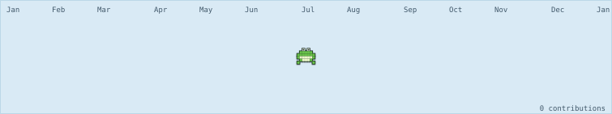
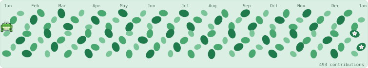
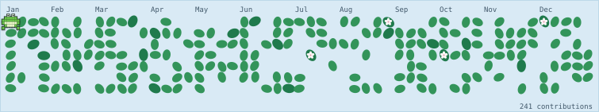
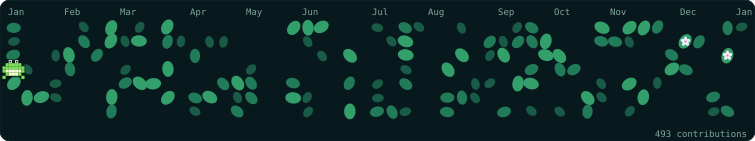

# frog-contribution-graph

Your GitHub contribution graph as a Bengali pond. A frog hops your year; your
busiest days ripple the water.

One self-contained animated SVG, generated daily by GitHub Actions. No
dependencies, no JavaScript on the viewer's side, and a static pond for anyone
with `prefers-reduced-motion`.

<picture>
  <source media="(prefers-color-scheme: dark)"
          srcset="https://raw.githubusercontent.com/ashik-maybe/frog-contribution-graph/output/pond-night.svg">
  <source media="(prefers-color-scheme: light)"
          srcset="https://raw.githubusercontent.com/ashik-maybe/frog-contribution-graph/output/pond-day.svg">
  
</picture>

## What you might get

Every tile below is generated by this repo from a deterministic synthetic
year, so you can see the full range before wiring the action in. Click a
tile to open the animated SVG (GitHub will not play SMIL inline). Your pond
always reflects your own data.

<table>
  <tr>
    <td align="center">
      <a href="example/animated/empty.svg"></a><br>
      <b>Empty</b><br><sub>A year with no pushes yet — a bare pond and one resting frog</sub>
    </td>
    <td align="center">
      <a href="example/animated/sparse.svg"></a><br>
      <b>Sparse</b><br><sub>A handful of pushes — a few large pads; the frog dives between them</sub>
    </td>
    <td align="center">
      <a href="example/animated/normal.svg"></a><br>
      <b>Normal</b><br><sub>Steady work — pad size follows relative intensity</sub>
    </td>
  </tr>
  <tr>
    <td align="center">
      <a href="example/animated/dense.svg"></a><br>
      <b>Dense</b><br><sub>A green wall — pads shrink so the carpet keeps its texture</sub>
    </td>
    <td align="center">
      <a href="example/animated/tied.svg"></a><br>
      <b>Tied</b><br><sub>Many identical small days — flat pads, no invented contrast</sub>
    </td>
    <td align="center">
      <a href="example/animated/night.svg"></a><br>
      <b>Night</b><br><sub>Monsoon night — the same pond, dark palette</sub>
    </td>
  </tr>
</table>

Both directories under `example/` regenerate with `npm run examples`, and the
SVGs are checked in so they never go stale silently.

## Use it

In your own profile repo, add `.github/workflows/pond.yml`:

```yaml
name: Pond
on:
  schedule:
    - cron: "0 3 * * *"
  workflow_dispatch:
permissions:
  contents: write
jobs:
  pond:
    runs-on: ubuntu-latest
    steps:
      - uses: ashik-maybe/frog-contribution-graph@v1
        with:
          github_user_name: ${{ github.repository_owner }}
      - uses: crazy-max/ghaction-github-pages@v4
        with:
          target_branch: output
          build_dir: dist
```

Then embed it in your README:

```html
<picture>
  <source media="(prefers-color-scheme: dark)"
          srcset="https://raw.githubusercontent.com/YOU/YOU/output/pond-night.svg">
  <source media="(prefers-color-scheme: light)"
          srcset="https://raw.githubusercontent.com/YOU/YOU/output/pond-day.svg">
  
</picture>
```

## Inputs

| Input | Required | Default | What it does |
| --- | --- | --- | --- |
| `github_user_name` | yes | — | Username whose calendar becomes the pond |
| `github_token` | no | `${{ github.token }}` | GraphQL token. A PAT is needed for private contributions |
| `output_dir` | no | `dist` | Where the two SVGs are written |

## How it works

1. `contributionsCollection` comes from the GraphQL API (REST does not expose
   the calendar), one year ending today.
2. Weeks become a 53x7 grid; pads are ellipses sized by sqrt(count / p95)
   relative to your own busiest stretch (p95, so one huge day can't flatten
   the rest). Distributions with no real variance get flat, uniform pads
   instead of invented contrast.
3. The frog lands once per active week, on that week's busiest day.
   Wide gaps (> 2 columns) make the frog dive and surface on the far pad.
4. The hop is a quadratic arc implemented as SMIL animateTransform translate
   keyframes (sit, arc, land-squash); each landing emits a fading ring.
5. Up to eight shapla blooms open on your year's strongest days; month
   labels follow the Intl locale option (default `en`).
6. Output is deterministic: the same grid gives byte-identical SVG, so the
   daily Action only needs to commit on real change.

## Design

- **Morning pond / monsoon night.** Two palettes, one pond. Light is pale water
  and open flowers; dark is deep teal and moonlight ripples.
- **Reduced motion.** The SMIL animation is wrapped in media queries; a static
  pond renders for `prefers-reduced-motion: reduce`.
- **Zero dependencies.** Plain ESM plus `fetch`, so the action starts in
  milliseconds and has no supply chain to audit.

## Roadmap

- [x] **Shapla blooms** — a white-and-pink flower opens on your top 5% of days
- [x] **River current** — faint drift lines so the water reads as moving
- [ ] **Monsoon theme** — raindrops instead of pads

## Develop

```sh
npm test                              # node --test
npm run examples                      # regenerate example/preview and example/animated
npm run generate -- --user YOU --token $GITHUB_TOKEN
```

Requires Node 20+. The action itself runs on `node24` inside GitHub's runners;
locally, Bun works too because the code is standard ESM.

## License

MIT
