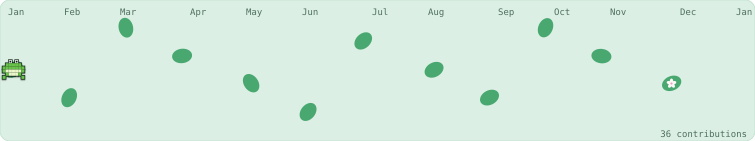
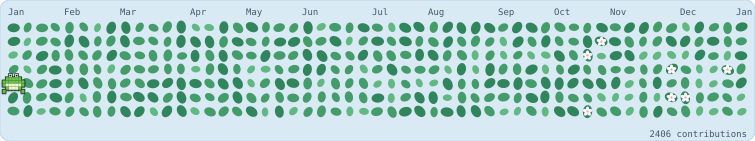
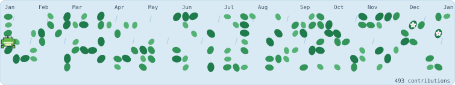
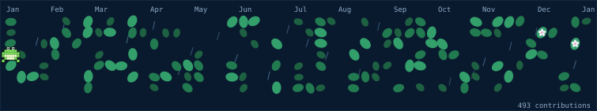

# frog-contribution-graph

Your GitHub contribution graph as a Bangladeshi pond. A frog hops your year; your
busiest days ripple the water.

One self-contained animated SVG, generated daily by GitHub Actions. No
dependencies, no JavaScript on the viewer's side, and a static pond for anyone
with `prefers-reduced-motion`.

Inspired by Bangladesh's shapla — the water lily — and the ponds it blooms in.
The pond is a familiar image everywhere, so any profile can wear it.

[](https://github.com/ashik-maybe/frog-contribution-graph/actions/workflows/test.yml)
[](LICENSE)

<picture>
  <source media="(prefers-color-scheme: dark)"
          srcset="https://raw.githubusercontent.com/ashik-maybe/frog-contribution-graph/output/pond-night.svg">
  <source media="(prefers-color-scheme: light)"
          srcset="https://raw.githubusercontent.com/ashik-maybe/frog-contribution-graph/output/pond-day.svg">
  
</picture>

## Use it

In your own profile repo, add `.github/workflows/pond.yml`:

```yaml
name: Pond
on:
  schedule:
    - cron: "0 3 * * *"
  workflow_dispatch:
permissions:
  contents: write
jobs:
  pond:
    runs-on: ubuntu-latest
    steps:
      - uses: ashik-maybe/frog-contribution-graph@v1
        with:
          github_user_name: ${{ github.repository_owner }}
      - uses: crazy-max/ghaction-github-pages@v4
        with:
          target_branch: output
          build_dir: dist
```

Then embed it in your README:

```html
<picture>
  <source media="(prefers-color-scheme: dark)"
          srcset="https://raw.githubusercontent.com/YOU/YOU/output/pond-night.svg">
  <source media="(prefers-color-scheme: light)"
          srcset="https://raw.githubusercontent.com/YOU/YOU/output/pond-day.svg">
  
</picture>
```

## Inputs

| Input | Required | Default | What it does |
| --- | --- | --- | --- |
| `github_user_name` | yes | — | Username whose calendar becomes the pond |
| `github_token` | no | `${{ github.token }}` | GraphQL token. A PAT is needed for private contributions |
| `output_dir` | no | `dist` | Where `pond-day.svg` and `pond-night.svg` are written |
| `seasonal_effects` | no | `true` | Faint rain during borsha (Asharh-Srabon, about Jun 15 - Aug 16, Bangladesh time); `false` opts out. |

## What you might get

Every tile below is generated by this repo from a deterministic synthetic
year, so you can see the full range before wiring the action in. Click a
tile to open the animated SVG (GitHub will not play SMIL inline). Your pond
always reflects your own data.

<table>
  <tr>
    <td align="center">
      <a href="example/animated/empty.svg"></a><br>
      <b>Empty</b><br><sub>A year with no pushes yet — a bare pond and one resting frog</sub>
    </td>
    <td align="center">
      <a href="example/animated/sparse.svg"></a><br>
      <b>Sparse</b><br><sub>A handful of pushes — a few large pads; the frog dives between them</sub>
    </td>
    <td align="center">
      <a href="example/animated/normal.svg"></a><br>
      <b>Normal</b><br><sub>Steady work — pad size follows relative intensity</sub>
    </td>
  </tr>
  <tr>
    <td align="center">
      <a href="example/animated/dense.svg"></a><br>
      <b>Dense</b><br><sub>A green wall — pads shrink so the carpet keeps its texture</sub>
    </td>
    <td align="center">
      <a href="example/animated/tied.svg"></a><br>
      <b>Tied</b><br><sub>Many identical small days — flat pads, no invented contrast</sub>
    </td>
    <td align="center">
      <a href="example/animated/night.svg"></a><br>
      <b>Night</b><br><sub>Monsoon night — the same pond, deep blue</sub>
    </td>
  </tr>
</table>

And during borsha:

<table>
  <tr>
    <td align="center">
      <a href="example/animated/monsoon.svg"></a><br>
      <b>Monsoon</b><br><sub>Borsha — faint rain over the same pond</sub>
    </td>
    <td align="center">
      <a href="example/animated/monsoon-night.svg"></a><br>
      <b>Monsoon night</b><br><sub>Monsoon night — faint rain over deep blue water</sub>
    </td>
  </tr>
</table>

Both directories under `example/` regenerate with `npm run examples`, and the
SVGs are checked in so they never go stale silently.

## Reading the pond

| What you see | What it encodes |
| --- | --- |
| Pad size and colour | Contributions vs your own p95 day |
| Frog's route | Busiest day of each active week |
| Splash ring | A frog landing |
| Shapla bloom | One of your eight highest days |
| Rain, currents, water | Scenery — never data |

## Borsha, automatically

During the classical Bengali rain months (Asharh and Srabon, roughly
June 15 to August 16, Bangladesh time) the pond gets about two dozen faint
rain streaks with a small splash ring where each lands. It is scenery only:
pad colours never change, so the graph never lies. Automatic like GitHub's
Halloween grid; set `seasonal_effects: false` to opt out. The committed
monsoon previews (day and night) are forced-on so they look the same all year.

## Support

Open an issue at
[github.com/ashik-maybe/frog-contribution-graph/issues](https://github.com/ashik-maybe/frog-contribution-graph/issues).
Include your workflow snippet, the action version you used (`@v1` or a tag),
and what you expected instead. Maintained best-effort; please be patient.

## Privacy

No servers, no telemetry, no data collection. The action runs entirely inside
your GitHub Actions runner with your token and makes one network call: the
GitHub GraphQL API, to read the contribution calendar for the username you
pass as an input. Nothing else leaves your runner. See [EULA.md](EULA.md).

## Changelog

[CHANGELOG.md](CHANGELOG.md).

## Development

### How it works

1. `contributionsCollection` comes from the GraphQL API (REST does not expose
   the calendar), one year ending today.
2. Weeks become a 53x7 grid; pads are ellipses sized by `sqrt(count / p95)`
   relative to your own busiest stretch. Distributions with no real variance
   get flat, uniform pads instead of invented contrast. Shape detection
   (empty / sparse / normal / dense) adjusts pad scale, never counts.
3. The frog lands once per active week, on that week's busiest day. Wide gaps
   (> 2 columns) make the frog dive and surface on the far pad.
4. The hop is a quadratic arc implemented as SMIL `animateTransform`
   keyframes (sit, arc, land-squash); each landing emits a fading ring.
5. Up to eight shapla blooms open on your year's strongest days; month labels
   use Intl (the Action emits English today).
6. Water, currents and borsha rain are scenery; pads are data. Reduced motion
   gets a static pond; the square water rect keeps GitHub's rectangle tight.
7. Output is deterministic: the same grid gives byte-identical SVG, so the
   daily Action only needs to commit on real change.

### Design

- **Morning pond / monsoon night.** Water is pale sky-blue (#d9eaf5) by day
  and deep river-blue (#0a1a2e) at night. Pads stay green because they carry
  the data; blooms stay white-pink.
- **Accessible output.** `role="img"` with a `<title>` and a `<desc>` naming
  the active-day count and total contributions.
- **Zero dependencies.** Plain ESM plus `fetch`, so the action starts in
  milliseconds and has no supply chain to audit. The action itself runs on
  `node24`.

### Local development

```sh
npm test                              # node --test
npm run examples                      # regenerate example/preview and example/animated
npm run generate -- --user YOU --token $GITHUB_TOKEN
```

Requires Node 20+. The committed example SVGs are checked against the
generator in CI, so a render change must travel with regenerated previews.

Contributions: see [CONTRIBUTING.md](CONTRIBUTING.md). Security: see
[SECURITY.md](SECURITY.md).

## License

MIT — that license governs your use of this action; see
[LICENSE](LICENSE) and the end-user terms in [EULA.md](EULA.md).
