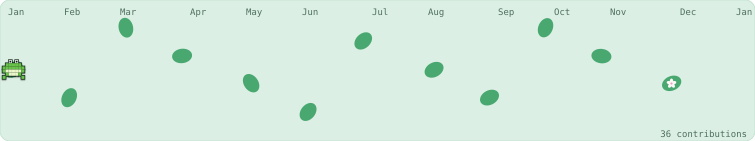
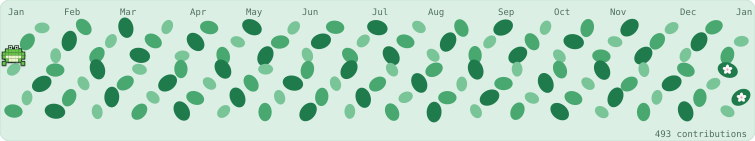
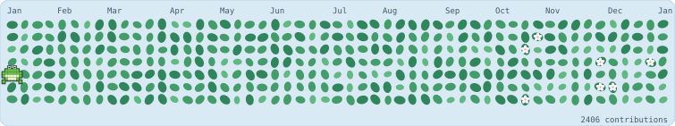
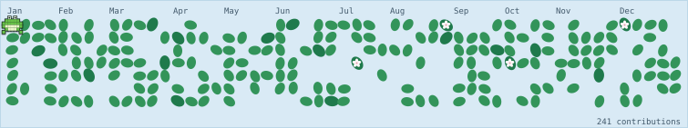
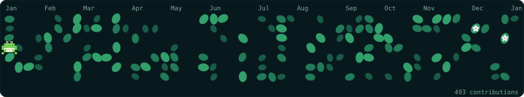

# examples/

What your pond could look like. Both directories are generated by
`npm run examples` from `fixtures.mjs` and committed; `preview/` has no SMIL
so the tiles render statically on GitHub, and `animated/` keeps the full
motion for browsers.

<table>
  <tr>
    <td align="center">
       
      <b>Empty</b> A year with no pushes yet — a bare pond and one resting frog
    </td>
    <td align="center">
       
      <b>Sparse</b> A handful of pushes — a few large pads; the frog dives between them
    </td>
    <td align="center">
       
      <b>Normal</b> Steady work — pad size follows relative intensity
    </td>
  </tr>
  <tr>
    <td align="center">
       
      <b>Dense</b> A green wall — pads shrink so the carpet keeps its texture
    </td>
    <td align="center">
       
      <b>Tied</b> Many identical small days — flat pads, no invented contrast
    </td>
    <td align="center">
       
      <b>Night</b> Monsoon night — the same pond, dark palette
    </td>
  </tr>
</table>

- Shape detection: empty (0 active) / sparse (<8% of days) / normal /
  dense (>85%) — drives pad scale, never counts.
- Degenerate years (all active days within 1 contribution) render flat
  uniform pads on purpose — the data has no contrast to show.
- p95 sizing: pads are normalised against your 95th-percentile day, so one
  huge day never flattens the rest of the year.
- To regenerate: `npm run examples`. CI fails if the committed SVGs drift
  from the generator.
- "tied" is a real common case (most days at 1 contribution), not an error.
